# 🏰 Оплот

Средневековый градостроительный симулятор с обороной от орков и рейдами на чужие города. Игра работает в браузере, весь код лежит в одном файле `index.html`.

Демо в Telegram: [@Apowerfularmybot](https://t.me/Apowerfularmybot)

  

## Об игре

Вы строите свой город: дома, поля, казармы, башни и стены. Крестьяне работают на полях и приносят золото. На него вы укрепляете оборону и собираете армию.

Волны орков идут к вашей ратуше и ломают всё, что встретят на пути. Чем дальше, тем их больше и тем они сильнее. А когда город в безопасности, можно отправить армию штурмовать чужие поселения.

## Как играть

| Что | Как это работает |
|---|---|
| 🏠 Дом | +3 крестьянина |
| 🌾 Поле | 2 золота в секунду с каждого работника |
| 🗼 Башня | стреляет по оркам |
| 🧱 Стена | задерживает орков, пока их бьют башни |
| ⛺ Казарма | +5 мест для воинов |

- **Таймер волн** запускается после первой постройки: орки приходят примерно каждые 45 секунд. За отбитую волну даётся награда.
- **Воины** нанимаются за золото, а снаряжение усиливает всю армию. Воины, оставшиеся дома, помогают ратуше стрелять.
- **Вылазка** в лес приносит немного добычи при небольшом риске.

## Рейды

  

Армия уходит в поход на 12 секунд, и пока её нет, город остаётся без защиты. Ход штурма виден на поле: воины идут к крепости, башни стреляют, павшие остаются на земле, здания горят. В бою побеждает сильнейший: исход зависит от числа воинов, снаряжения и доли случайности.

Захваченный город приносит добычу и постоянную дань: 4 золота в секунду.

| Цель | Защита | Добыча |
|---|---|---|
| Деревня Гримвуд | ~15 | 80 |
| Форт Рейвенхолл | ~45 | 200 |
| Цитадель Барона | ~100 | 450 |

> Пока вместо настоящих игроков работают боты. Рейды на реальных игроков можно добавить позже.

## Управление

- **Компьютер:** выберите здание на панели и кликните по клетке поля.
- **Телефон:** коснитесь клетки, чтобы выбрать её. Повторное касание построит здание. Панель построек закреплена внизу экрана.
- Кнопка над полем переключает вид между вашим городом и походом.

## Запуск

Откройте `index.html` в любом браузере. Ничего устанавливать не нужно.

Чтобы выложить игру в интернет через GitHub Pages:

1. Загрузите `index.html` и папку `assets` в репозиторий.
2. Откройте **Settings → Pages**.
3. В разделе **Build and deployment** выберите ветку `main` и папку `/ (root)`.
4. Через минуту игра станет доступна по адресу `https://<ваш-логин>.github.io/<репозиторий>/`.

## Технологии

- HTML, CSS и JavaScript без библиотек и сборки
- Canvas для отрисовки поля
- Интерфейс адаптирован под телефоны и поддерживает светлую и тёмную темы

## Что дальше

- [ ] Разные типы орков и осадные машины
- [ ] Улучшение построек
- [ ] Ответные атаки ботов на ваш город
- [ ] Сохранение прогресса
- [ ] Рейды на настоящих игроков

## Статус

Это демо-версия, баланс ещё будет меняться.
